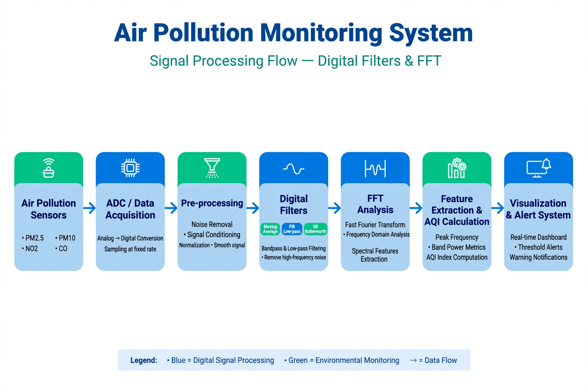

# Air Pollution Monitoring with Digital Filters and FFT

A DSP case study demonstrating how moving-average, FIR, and Butterworth filters can be applied to a simulated air-pollution signal, followed by frequency analysis using the Fast Fourier Transform (FFT).

> **Scope:** The included scripts generate synthetic PM2.5 data for demonstration. They do not read from physical sensors, calculate an AQI, or issue alerts. The architecture diagram shows a broader proposed monitoring system.

## System architecture

The diagram illustrates a possible end-to-end monitoring flow, from sensor acquisition through preprocessing, filtering, FFT analysis, feature extraction, and visualization.



## What the scripts do

Both scripts generate one day of synthetic PM2.5 measurements from a trend, a daily-cycle component, and random noise. They apply a moving-average filter, an FIR low-pass filter, and a fourth-order Butterworth low-pass filter, then perform FFT analysis.

- `code/main.py` plots the raw signal alongside the Butterworth-filtered signal and plots the FFT magnitude spectrum. It saves the plots as `images/filtered_result.png` and `images/fft_spectrum.png`, then prints the frequency corresponding to the largest non-zero FFT bin.
- `code/matlab_code.m` performs the same general simulation and filtering in MATLAB and displays the time-domain and FFT plots.

## Requirements

For the Python script:

- Python 3
- NumPy
- SciPy
- Matplotlib

## Run the Python script

From the repository root:

```bash
python -m pip install -r requirements.txt
python code/main.py
```

The script opens plot windows and saves the generated images in `images/`. Run it from the repository root so the relative output paths resolve correctly.

## Run the MATLAB script

Open `code/matlab_code.m` in MATLAB and run it. The script uses Signal Processing Toolbox functions (`fir1` and `butter`).

## Repository layout

```text
.
├── code/
│   ├── main.py
│   └── matlab_code.m
├── images/
│   └── block_diagram.jpg
├── requirements.txt
└── README.md
```

## Possible extensions

- Connect supported air-quality sensors and implement data acquisition.
- Add validated AQI calculation and threshold-based notifications.
- Compare filter responses and quantify performance on measured data.
- Explore wavelet analysis or deployment on an edge device such as an ESP32.
